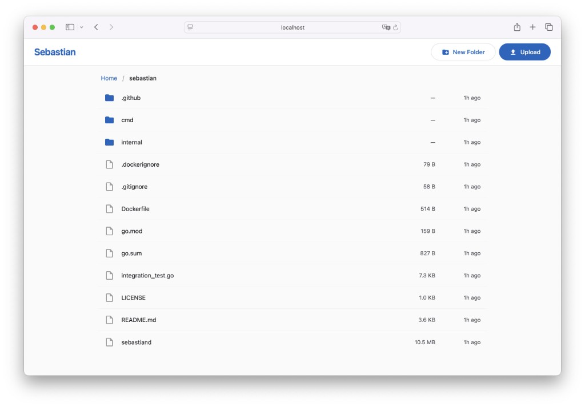

# Sebastian

A simple, reliable single-node file server that projects S3, WebDAV, SFTP, and HTTP UI protocols onto a local directory. Think of it as a protocol gateway for your filesystem.



## Features

- **S3-compatible API** — path-style and virtual-hosted-style addressing, ListBuckets, GetObject, PutObject, CopyObject, DeleteObject, DeleteObjects, ListObjectsV1/V2, conditional requests, folder markers
- **S3 multipart uploads** — CreateMultipartUpload, UploadPart, UploadPartCopy, CompleteMultipartUpload, AbortMultipartUpload, ListParts, ListMultipartUploads; crash-safe staging, TTL cleanup, per-part checksums and idempotent completion
- **WebDAV** — full PROPFIND/GET/PUT/DELETE/MKCOL/MOVE/COPY/LOCK/UNLOCK support, compatible with macOS Finder, Windows Explorer, Cyberduck, rclone
- **SFTP** — SSH File Transfer Protocol v3, compatible with OpenSSH sftp, FileZilla, WinSCP
- **HTTP UI** — Material 3 styled web file browser with upload, download, rename, delete, drag-and-drop folder upload
- **Durable atomic uploads** — HTTP, WebDAV PUT and S3 publish flushed temporary files by rename; SFTP writes directly to open files
- **Recoverable COPY/MOVE** — private copy staging and filesystem journals preserve replaced data across process crashes
- **Path traversal protection** — three-layer defense (textual check + absolute path verification + symlink-escape resolution), applied uniformly across all gateways
- **Fails closed** — an enabled gateway refuses to start without both of its credentials unless anonymous access is requested explicitly

## Quick Start

Current release: **v1.7.0**. Read the [release and upgrade notes](docs/releases/v1.7.0.md)
before upgrading an existing server: v1.7.0 refuses configurations that earlier
releases accepted with only a warning.

### Docker

```bash
docker run -d \
  -p 127.0.0.1:9200:9200 -p 127.0.0.1:9400:9400 \
  -v /path/to/files:/data/files \
  -e SEBASTIAN_S3_ACCESS_KEY=choose-a-key -e SEBASTIAN_S3_SECRET_KEY=choose-a-secret \
  -e SEBASTIAN_HTTP_USERNAME=admin -e SEBASTIAN_HTTP_PASSWORD=choose-a-password \
  solkin/sebastian:1.7.0
```

Open http://localhost:9400 for the web UI. Use any S3 client against http://localhost:9200.

The image enables S3 and the web UI. An enabled gateway needs both of its
credentials; Sebastian refuses to start otherwise. To serve a gateway without
authentication on purpose, set its `allow_anonymous: true`
(`SEBASTIAN_S3_ALLOW_ANONYMOUS=true`, `SEBASTIAN_HTTP_ALLOW_ANONYMOUS=true`).
`sebastiand -version` prints the release.

### Binary

```bash
go install github.com/solkin/sebastian/cmd/sebastiand@latest
sebastiand -config config.yaml
```

## Configuration

Sebastian can be configured via a YAML file, environment variables, or both. Environment variables take precedence.

### YAML

```yaml
root_dir: /data/files
access_log: true              # one line per request
max_upload_bytes: 0           # cap a single upload (bytes); 0 = unlimited for S3/WebDAV/SFTP, 1 GiB default for HTTP UI

multipart:                    # S3 multipart upload limits and retention
  min_part_bytes: 5242880     # 5 MiB — minimum size of every part but the last
  max_part_bytes: 5368709120  # 5 GiB — maximum size of a single part
  max_parts: 10000            # highest accepted part number
  max_active_uploads: 10000   # simultaneously staged uploads; 0 = unlimited
  max_concurrent_part_uploads: 0  # in-flight part uploads; 0 = unlimited
  upload_ttl: 168h            # discard an untouched incomplete upload after this
  cleanup_interval: 1h        # how often the janitor sweeps
  temp_file_max_age: 24h      # age at which an orphaned scratch file is removed

gateways:
  s3:
    enabled: true
    listen_addr: ":9200"
    access_key: "choose-a-key"
    secret_key: "choose-a-secret"
    # allow_anonymous: true   # the only way to serve an enabled gateway without credentials
    domain: ""
    buckets: []               # created at startup when missing
  webdav:
    enabled: false
    listen_addr: ":9300"
    username: ""
    password: ""
  http:
    enabled: true
    listen_addr: ":9400"
    username: "admin"
    password: "choose-a-password"
  sftp:
    enabled: false
    listen_addr: ":9500"
    username: ""              # client auth; both empty needs allow_anonymous: true
    password: ""              # client auth
    host_key_path: "/etc/sebastian/sftp_host_key"  # server identity key (required)
```

### Environment Variables

| Variable | Description | Default |
|---|---|---|
| `SEBASTIAN_ROOT_DIR` | Root directory to serve | `/data/files` |
| `SEBASTIAN_ACCESS_LOG` | One info line per request (method, URL without credentials, status, size, duration, client address, `X-Forwarded-For`) | `true` |
| `SEBASTIAN_MAX_UPLOAD_BYTES` | Max size of a single upload in bytes (`0` = unlimited for S3/WebDAV/SFTP; HTTP UI defaults to 1 GiB) | `0` |
| `SEBASTIAN_MULTIPART_MIN_PART_BYTES` | Minimum size of every multipart part but the last | `5242880` (5 MiB) |
| `SEBASTIAN_MULTIPART_MAX_PART_BYTES` | Maximum size of a single multipart part | `5368709120` (5 GiB) |
| `SEBASTIAN_MULTIPART_MAX_PARTS` | Highest accepted part number | `10000` |
| `SEBASTIAN_MULTIPART_MAX_ACTIVE_UPLOADS` | Simultaneously staged uploads (`0` = unlimited) | `10000` |
| `SEBASTIAN_MULTIPART_MAX_CONCURRENT_PART_UPLOADS` | In-flight part uploads (`0` = unlimited); over the cap returns `SlowDown` | `0` |
| `SEBASTIAN_MULTIPART_UPLOAD_TTL` | Retention for untouched incomplete uploads (duration, e.g. `168h`) | `168h` |
| `SEBASTIAN_MULTIPART_CLEANUP_INTERVAL` | How often the janitor sweeps (duration) | `1h` |
| `SEBASTIAN_MULTIPART_TEMP_FILE_MAX_AGE` | Age at which an orphaned scratch file is removed (duration) | `24h` |
| `SEBASTIAN_S3_ENABLED` | Enable S3 gateway | `false` |
| `SEBASTIAN_S3_LISTEN_ADDR` | S3 listen address | `:9200` |
| `SEBASTIAN_S3_ACCESS_KEY` | S3 access key | |
| `SEBASTIAN_S3_SECRET_KEY` | S3 secret key | |
| `SEBASTIAN_S3_ALLOW_ANONYMOUS` | Serve S3 without credentials | `false` |
| `SEBASTIAN_S3_DOMAIN` | Base domain for virtual-hosted-style S3 (empty = path-style only) | |
| `SEBASTIAN_S3_BUCKETS` | Comma-separated buckets to create at startup when missing | |
| `SEBASTIAN_WEBDAV_ENABLED` | Enable WebDAV gateway | `false` |
| `SEBASTIAN_WEBDAV_LISTEN_ADDR` | WebDAV listen address | `:9300` |
| `SEBASTIAN_WEBDAV_USERNAME` | WebDAV username | |
| `SEBASTIAN_WEBDAV_PASSWORD` | WebDAV password | |
| `SEBASTIAN_WEBDAV_ALLOW_ANONYMOUS` | Serve WebDAV without credentials | `false` |
| `SEBASTIAN_HTTP_ENABLED` | Enable HTTP UI gateway | `false` |
| `SEBASTIAN_HTTP_LISTEN_ADDR` | HTTP UI listen address | `:9400` |
| `SEBASTIAN_HTTP_USERNAME` | HTTP UI username | |
| `SEBASTIAN_HTTP_PASSWORD` | HTTP UI password | |
| `SEBASTIAN_HTTP_ALLOW_ANONYMOUS` | Serve the web UI without credentials | `false` |
| `SEBASTIAN_SFTP_ENABLED` | Enable SFTP gateway | `false` |
| `SEBASTIAN_SFTP_LISTEN_ADDR` | SFTP listen address | `:9500` |
| `SEBASTIAN_SFTP_USERNAME` | SFTP username for client auth | |
| `SEBASTIAN_SFTP_PASSWORD` | SFTP password for client auth | |
| `SEBASTIAN_SFTP_ALLOW_ANONYMOUS` | Accept SFTP connections without a password | `false` |
| `SEBASTIAN_SFTP_HOST_KEY_PATH` | Path to server identity key file (required, auto-generated on first run) | |

At least one gateway must be enabled. When SFTP is enabled, `host_key_path` must be explicitly set.

Startup fails closed:

- An enabled gateway needs both credentials (`access_key`/`secret_key`,
  `username`/`password`). With neither, it starts only with
  `allow_anonymous: true`, and a warning is logged; one credential alone is
  always an error, because an empty secret or password is a value anyone can
  use. Values starting with `changeme` are rejected as examples.
- A nonempty environment value that does not parse (a number, duration or
  boolean — `true`/`false`, `yes`/`no`, `1`/`0`) stops startup instead of
  falling back to the default.
- A gateway that fails, such as one whose port is taken, stops the server with
  a nonzero exit status.

On SIGTERM open transfers get 8 seconds to finish; give a container runtime more
than that before it sends SIGKILL (`stop_grace_period: 30s` in compose). Every
gateway abandons a transfer that makes no progress for five minutes in either
direction; a slow transfer that keeps moving is not cut off.

### Upload limit defaults

Omitting `multipart.max_active_uploads` limits the server to 10,000 staged
uploads. Explicit `0` disables this cap in either YAML or the environment;
environment values override YAML. Negative YAML upload limits are rejected.
`max_upload_bytes: 0` leaves S3, WebDAV, and SFTP uploads unlimited; the HTTP
browser retains its 1 GiB default request limit.

### SFTP Notes

SFTP runs over SSH, which requires two separate mechanisms:

- **Server identity key** (`host_key_path`) — the server's cryptographic identity, similar to a TLS certificate. SSH clients verify this key to ensure they are connecting to the correct server. The key file is auto-generated on first startup if it does not exist at the specified path (a warning is logged when this happens). Keep the same file across restarts to avoid "host key changed" warnings in clients — in Docker, mount a volume covering the key path (the image stores it at `/data/sftp_host_key` and declares `/data` as a volume, so a named volume like `-v sebastian-data:/data` persists it across container recreation).
- **Client authentication** (`username` / `password`) — credentials that clients must provide to connect. Both are required; with both empty the gateway starts only with `allow_anonymous: true`, and then any client can connect. One of them alone admits nobody.

#### Connecting

```bash
# With authentication:
sftp -P 9500 user@localhost

# Without authentication (allow_anonymous: true):
sftp -P 9500 -o User=anonymous localhost
```

On first connection, the client will ask to trust the server's host key — this is normal SSH behavior.

## S3 Bucket Mapping

S3 buckets map to first-level subdirectories of `root_dir`:

```
root_dir/
  photos/        ← bucket "photos"
    img.jpg      ← object "img.jpg"
    2024/
      jan.jpg    ← object "2024/jan.jpg"
  documents/     ← bucket "documents"
```

`root_dir/.sebastian/` is reserved for sebastian's own state (multipart staging).
It is not a bucket, is hidden from every gateway's listings, and cannot be read or
written through any protocol.

Buckets listed in `buckets` (`SEBASTIAN_S3_BUCKETS`) are created at startup when
missing, so they exist before a client that does not create buckets, such as a
backup tool, first uses one. A name that cannot be a bucket stops startup.

## S3 Copies, Folders and Conditional Requests

- **CopyObject** (`x-amz-copy-source`) copies the source into a scratch file next
  to the destination and publishes it atomically; a source replaced during the
  copy answers `503 SlowDown` (SDKs retry). Copying an object onto itself
  (`--metadata-directive REPLACE`) changes nothing, as metadata is not stored.
  `x-amz-copy-source-if-*` conditions are honoured; `versionId` is not supported.
- **UploadPartCopy** copies a byte range (`x-amz-copy-source-range`) into a part,
  so `aws s3 cp`/`mv` between keys works for objects of any size.
- **Folder markers**: `PUT bucket/prefix/` with an empty body creates the
  directory; `HEAD`/`GET` of `prefix/` answer `200` while it exists; `DELETE
  prefix/` removes it only when empty.
- **Conditional requests**: `GET`/`HEAD` evaluate `If-Match`,
  `If-Unmodified-Since` (`412`), `If-None-Match` and `If-Modified-Since` (`304`);
  an unsatisfiable range answers `416 InvalidRange`. `PUT` and Complete with
  `If-None-Match: *` or `If-Match` are decided atomically at publication.
- **Errors** keep S3 codes: `NoSuchBucket`, `KeyTooLongError`, `ParentIsObject`,
  `ObjectExistsAsDirectory`, `InvalidArgument` for NUL or invalid UTF-8 keys. An
  upload whose declared length exceeds `max_upload_bytes` is refused with `413`
  before its body is sent.
- **Content-Type** is derived from the extension for a safe set (`.apk`, common
  images, `.json`, `.txt`, `.pdf`, `.zip`) and is `application/octet-stream` for
  everything else, including HTML, SVG and scripts. Every response carries
  `X-Content-Type-Options: nosniff`.

## S3 Batch Deletes

DeleteObjects (`POST /{bucket}?delete`) deletes up to 1000 keys in one request,
each exactly as DeleteObject would: a missing key counts as deleted, a key naming
a directory removes nothing, and emptied parent directories stay. A key that
cannot be deleted — longer than S3's 1024 bytes, outside the bucket, or one the
server cannot look at — is reported in the result without failing the others;
`Quiet` leaves the deleted keys out. `Content-MD5` and a concrete `x-amz-content-sha256`
are enforced when present, so a captured signed request cannot be replayed with
other keys. `VersionId` is ignored, as buckets are not versioned.

## S3 Multipart Uploads

The full multipart API is supported, so `aws s3 cp` of a large file, `aws s3api`,
boto3, rclone, and the S3 SDKs upload in parallel chunks out of the box:

| Operation | Request |
|---|---|
| CreateMultipartUpload | `POST /{bucket}/{key}?uploads` |
| UploadPart | `PUT /{bucket}/{key}?partNumber={n}&uploadId={id}` |
| CompleteMultipartUpload | `POST /{bucket}/{key}?uploadId={id}` |
| AbortMultipartUpload | `DELETE /{bucket}/{key}?uploadId={id}` |
| ListParts | `GET /{bucket}/{key}?uploadId={id}` |
| ListMultipartUploads | `GET /{bucket}?uploads` |

### Durability and integrity

- Parts are staged under `root_dir/.sebastian/multipart/{uploadId}/`, never inside
  a bucket, so an incomplete upload is invisible to every protocol and its parts
  never show up as objects.
- Each part is streamed to a scratch file, hashed, and published with a single
  atomic rename. An interrupted transfer leaves nothing staged, and re-sending a
  part number simply replaces it — retrying a failed part is always safe.
- `Content-MD5` on `UploadPart` is enforced when present, as is a concrete
  `x-amz-content-sha256` (the digest the request's signature covers), so a
  captured signed request cannot be replayed with a swapped part body. The
  response `ETag` is the part's MD5.
- Completion validates the client's part list the way S3 does: parts must be
  strictly ascending, every `ETag` must match what was staged, and every part but
  the last must reach `min_part_bytes` (`InvalidPartOrder`, `InvalidPart`,
  `EntityTooSmall`).
- Assembly re-hashes every part as it is copied and checks the finished file's
  size before publishing it, so a part corrupted on disk fails the completion
  instead of producing a bad object. The object appears under its key with a
  single atomic rename, in the same directory, so it works even when a bucket is
  a separate mount.
- Atomic-write scratch files (`.seb-tmp-*`, `.seb-bak-*`) are a reserved
  namespace: they are never reported as objects by `ListObjects`, and no gateway
  will create a file with one of those prefixes — such a name is refused up front
  rather than accepted and then swept away as an orphan.
- All upload state lives on disk, so a restart mid-upload loses nothing: the new
  process can accept further parts for, complete, or abort an upload its
  predecessor started.

### Retention

A background janitor removes uploads left untouched for `upload_ttl` (the
equivalent of an `AbortIncompleteMultipartUpload` lifecycle rule) and orphaned
atomic-write scratch files older than `temp_file_max_age`. An upload's age is
measured from its most recent activity, so a slow transfer that keeps sending
parts is never collected out from under the client. A bucket with in-progress
uploads cannot be deleted (`BucketNotEmpty`).

### ETag semantics

Object ETags are derived from size and modification time rather than content.
PutObject, CopyObject and CompleteMultipartUpload return the same ETag that a
later `GET`, `HEAD` or `LIST` reports for that object. Part ETags in UploadPart,
UploadPartCopy, ListParts and Complete are the parts' MD5.

Repeating `CompleteMultipartUpload` with the same part list — a client retry after
a timeout — returns the original result while the object is unchanged and within
`upload_ttl`, instead of `NoSuchUpload`. The Complete request body is checked
against `Content-MD5` and a concrete `x-amz-content-sha256`.

Plain `PutObject` also validates `Content-MD5` and a concrete
`x-amz-content-sha256`. A checksum mismatch rejects the upload without replacing
an existing object.

## S3 Authentication

When `access_key`/`secret_key` are set, requests must be signed with AWS Signature
Version 4 — either via the `Authorization` header or presigned query parameters.
Any S3 SDK or tool configured with the same credentials works out of the box.

- Legacy Signature V2 (`AWS key:signature`) is not supported.
- Presigned URLs are validated against their `X-Amz-Expires` window, which may
  not exceed 7 days (604800 seconds); the credential scope date must match
  `X-Amz-Date`.
- An access key without its secret key (or the reverse) admits nobody.
- When a client sends a concrete `x-amz-content-sha256` digest, uploads are
  re-hashed and rejected on mismatch, so a captured signed request cannot be
  replayed with a swapped body. Signed streaming bodies additionally verify
  the signature chain of their chunks and signed trailers. Run behind TLS for
  transport security, including when using `UNSIGNED-PAYLOAD`.

### Streaming uploads

PutObject and UploadPart decode `aws-chunked` before storing the bytes. Supported
modes are `STREAMING-AWS4-HMAC-SHA256-PAYLOAD`, its `-TRAILER` variant, and
`STREAMING-UNSIGNED-PAYLOAD-TRAILER`. Declared decoded length and flexible
checksums (CRC32, CRC32C, CRC64NVME, SHA1, SHA256) are checked before publication.
A failed checksum, signature, or framing check preserves the existing object or
part. Other streaming variants and streaming bodies on other operations return
`501 NotImplemented` before changing data.

Older versions could acknowledge these uploads while storing their framing.
Compare affected existing objects with their original checksums and upload the
originals again when they differ; upgrading does not repair those bytes.

S3 LIST keeps a bounded page of candidates while walking the full matching tree;
objects beyond the first 100000 remain available through V1/V2 pagination.

Leaving both keys empty disables authentication (all requests are allowed).

## Deployment

Sebastian serves plain HTTP (SFTP runs over SSH); it does not terminate TLS
itself. Run it behind a reverse proxy (nginx, Caddy, Traefik, …) that terminates
TLS for the S3, WebDAV, and HTTP UI ports. Configure the proxy to forward the
original `Host` header — the HTTP UI's CSRF protection compares the request
`Origin`/`Referer` host against it.

The container image runs as a non-root user; bind-mounted data directories must
be writable by that user.

[`docker-compose.yml`](docker-compose.yml) pins a release, requires every
credential from `.env`, waits 30 s on stop and rotates logs.
[`deploy/nginx.sebastian.conf.example`](deploy/nginx.sebastian.conf.example)
streams uploads and downloads without spooling them to the proxy's disk, keeps
upstream connections alive and re-resolves the container after it is recreated.

The access log writes one info line per request with the method, the URL
without presigned credentials, status, size, duration, client address and
`X-Forwarded-For`. Rotate the container log or set `access_log: false`.

Objects uploaded with `aws-chunked` bodies through v1.6.0 or earlier may hold
the chunk framing instead of their content; `docker exec sebastian
find-aws-chunked` lists candidates to compare with their originals.

## Building

```bash
go build -o sebastiand ./cmd/sebastiand
```

## Testing

See the [protocol parity contract](docs/protocol-parity.md) for shared behavior,
intentional differences, and the rules for porting protocol fixes.

```bash
go test -race ./...
```

## License

MIT

## Filesystem reliability

HTTP, WebDAV PUT and S3 uploads flush their file and changed parent directories
before acknowledging publication on filesystems that support directory flushing.
Windows retains file flushing with best effort directory durability. WebDAV COPY first builds an unpublished copy;
COPY/MOVE replacement journals under `.sebastian/transactions/` let startup roll
back an interrupted replacement or finish cleanup of a committed one. Recovery
checks object identities and checksums, preserves unexpected offline edits, and
stops startup when it cannot safely recover. Keep the journals and backup files;
finish pending operations before upgrading or backing up the volume. Old
`.seb-bak-*` files without journals require explicit restoration before startup.

Run one daemon per root directory: a process lease rejects a second instance.
The scratch janitor keeps active uploads even with old modification times and
never deletes recovery backups. SFTP preserves direct filesystem semantics:
writes are immediately visible, disconnect retains partial writes, and append
ignores the client offset. Writable CLOSE flushes the file; SFTP does not stage
a replacement generation or break hard links. External filesystem writers do
not take the gateway namespace lock; avoid editing paths involved in an active
COPY/MOVE or recovery operation.

Logging uses a bounded asynchronous queue. A stalled output consumer does not
block requests; overflow drops log records. Tagged Docker releases run tests
with the race detector and `go vet` before publishing an image.
